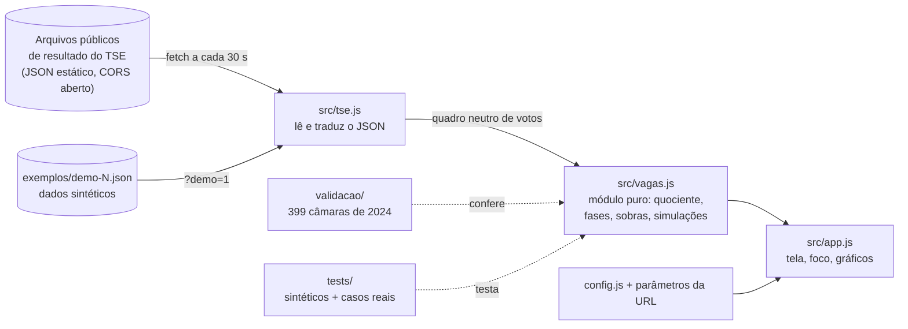

# Apuração ao vivo

**Live election count, in the browser.** A static page (no backend, no build, no cost) that reads the Brazilian electoral court's public result files every 30 seconds and computes, live, the electoral quotient, each party's quotient and the seat allocation by remainders (Electoral Code, arts. 106 to 111, current rules). It shows where a chosen candidate and their party or federation stand. The seat calculation lives in a pure JavaScript module with tests, and was checked against all 399 municipal councils of the state of Paraná in 2024: every one matched the official outcome (3,905 seats, 29 of them decided in the third phase).

**Demonstração ao vivo:** [loucytconsultoria.github.io/apuracao-ao-vivo/?demo=1](https://loucytconsultoria.github.io/apuracao-ao-vivo/?demo=1) (modo demo, com dados sintéticos; sem `?demo=1` a página lê o TSE).

## O problema

Numa eleição proporcional (deputados e vereadores), o tribunal eleitoral divulga os votos conforme as urnas são totalizadas, mas não diz, a cada leitura, **quem está eleito e quanto falta para alguém entrar**. Quem acompanha (partidos, candidatos, imprensa) precisa dessa resposta em minutos, e ela não é trivial:

- o quociente eleitoral depende do total de votos válidos, que muda a cada urna;
- as vagas se distribuem em fases (quociente partidário, sobras por maior média, sobras abertas a todos), com pisos de 10%, 20% e 80% do quociente;
- federações contam como um partido só;
- votos de candidatos com registro anulado ou sub judice não entram na conta.

Fazer isso à mão, ou numa planilha refeita a cada totalização, é lento e propenso a erro.

## A solução

Uma página estática que:

1. lê o arquivo público de resultados do TSE direto no navegador, a cada 30 s (o servidor do TSE libera CORS para qualquer origem, então não há backend);
2. refaz a distribuição de vagas com a regra vigente;
3. mostra o quociente eleitoral e os mínimos de 10%, 20% e 80%, as vagas por partido (por quociente, média e 3ª fase), os eleitos e a fila, e a posição de um candidato e da sua federação, com a conta do que falta para entrar (ou da folga de quem está dentro);
4. desenha a evolução durante a apuração.

Candidato, federação/partido, eleição, cargo e UF são **parâmetros**; por padrão nenhum candidato fica em foco.

## Arquitetura



| Arquivo | Papel |
|---|---|
| `src/vagas.js` | Cálculo puro (sem DOM, rede ou relógio). Roda no navegador e no Node. |
| `src/tse.js` | Monta o endereço do arquivo, lê e traduz o JSON do TSE para o quadro do `vagas.js`. |
| `src/app.js` | Interface: leitura periódica, foco em candidato/partido, tabelas, gráficos, busca. |
| `config.js` | Configuração de exemplo (intervalo, eleição padrão, foco, lista de eleições). |
| `exemplos/` | Quatro totalizações sintéticas (18%, 46%, 78%, 100%) de um estado fictício e o gerador. |
| `tests/` | `tests.html` (16 testes) e os casos reais agregados por partido. |
| `validacao/` | Conferência com as 399 câmaras do Paraná em 2024, em Python e no navegador. |

## Técnicas de engenharia

Não há modelo de IA aqui: é regra de negócio determinística, escrita para ser auditável. O que a torna confiável é o método.

- **Regra de negócio codificada fielmente.** Cada fase da conta aponta o artigo que implementa (no cabeçalho de `src/vagas.js`). As comparações com 10%, 20% e 80% do quociente usam aritmética de inteiros, sem ponto flutuante, e a comparação de médias é por multiplicação cruzada: não há arredondamento escondido.
- **Módulo puro e separado da interface.** O cálculo recebe um quadro neutro de votos e devolve dados; a leitura do TSE e a tela ficam em outros arquivos. Por isso o mesmo código é testado, validado e exibido.
- **Simulação para responder "quanto falta".** Busca binária sobre a própria função de distribuição: quantos votos a mais colocam um candidato na projeção, quantos a menos o tiram, quantos no primeiro suplente dão mais uma vaga ao partido. Os testes conferem que o número exato basta e um voto a menos não.
- **Duas implementações independentes.** A conferência em Python (`validacao/validar_2024.py`) foi escrita à parte do JavaScript; as duas chegam ao mesmo resultado nas 399 câmaras.
- **Zero infraestrutura.** HTML, CSS e JavaScript simples, sem framework, sem build, hospedável em qualquer servidor de arquivos (GitHub Pages incluído).

## Controles de qualidade

- **Validação contra o histórico.** `validacao/` refaz a distribuição das 399 câmaras municipais do Paraná na eleição de 2024 e compara com o resultado proclamado pelo TSE em quatro pontos: quociente eleitoral, lista de eleitos, fase de cada eleito (quociente ou sobra) e vagas por partido. Uma câmara só conta como igual se os quatro fecham.
- **Testes** (`tests/tests.html`): casos sintéticos para cada regra (frações do quociente, piso de 10%, empate de média, voto anulado, 3ª fase, art. 111, federação, fila, margens exatas), 300 cenários aleatórios com semente fixa que checam invariantes (todas as vagas distribuídas, nenhum candidato repetido, eleitos de um partido são os mais votados dele) e três casos reais agregados por partido, sem nenhum nome de pessoa.
- **Conferência cruzada na tela.** Quando o arquivo traz o quociente e as vagas proclamadas pelo TSE, a tela mostra as duas colunas lado a lado e avisa se o quociente calculado difere do oficial.
- **Transparência.** A seção "Como a conta é feita" explica as fases na própria página; a página diz que o resultado oficial é o que o TSE proclamar.

## Como rodar

Qualquer servidor de arquivos serve. Com Python:

```bash
python -m http.server 8000
# abra http://localhost:8000/index.html?demo=1
```

| Endereço | O que abre |
|---|---|
| `index.html?demo=1` | Demonstração com dados sintéticos (funciona sempre, mesmo fora do período de apuração). A cada 5 s avança uma totalização. |
| `index.html` | Eleição padrão de `config.js`, lida do TSE ao vivo. |
| `index.html?ano=2026&eleicao=6259&uf=pr&cargo=6&numero=NNNN&partido=SIGLA` | Eleição, cargo, UF, candidato e federação/partido em foco. |
| `index.html?ano=2024&eleicao=619&uf=pr&cargo=13&mun=75353` | Eleição municipal (vereador) de um município. |
| `tests/tests.html` | Roda os testes no navegador. |
| `validacao/index.html` | Refaz a conferência das 399 câmaras no navegador. |

Fora do período de apuração, os arquivos do TSE podem não estar no ar; a página avisa e oferece o modo demonstração. Para o resultado de eleições já encerradas, os arquivos costumam continuar disponíveis.

Conferência em Python (só biblioteca padrão):

```bash
python validacao/validar_2024.py --saida resumo.json
```

Para regenerar os arquivos sintéticos ou os casos reais agregados: `python exemplos/gerar_demo.py` e `python tests/dados/gerar_casos_reais.py`.

**GitHub Pages:** publique a raiz do repositório (Settings, Pages, branch principal, pasta `/`). Tudo é estático.

## Resultados mensuráveis

- **399 de 399** câmaras municipais do Paraná (2024) com resultado igual ao proclamado pelo TSE, somando **3.905 cadeiras**, **29** delas na 3ª fase das sobras. Confirmado por duas implementações independentes (Python e JavaScript).
- **16 testes** passando: 13 sintéticos (incluindo 300 cenários aleatórios) e 3 casos reais agregados por partido (câmara de 38 vagas, câmara de 9 vagas com 5 delas na 3ª fase, e uma eleição de deputado federal de 30 vagas com federações).
- Um teste de mutação simples (remover a regra dos 20%/80% das sobras) derruba 4 dos 16 testes: os testes de fato detectam erro na regra.
- Custo de operação: R$ 0, sem servidor, sem banco, sem chave de API.

## Limitações

- A projeção é uma conta sobre **votos parciais**: a ordem em que as urnas chegam muda o quadro, e a página não prevê as urnas que faltam.
- Depende do formato e da disponibilidade dos arquivos públicos do TSE, que não têm contrato de estabilidade; se o formato mudar, `src/tse.js` precisa de ajuste.
- A conferência histórica usa o resultado final de vereador (mesma regra de distribuição, em escala menor). Ela valida a conta, não a projeção feita com a apuração em andamento.
- Cobre eleições proporcionais. Não trata eleições majoritárias.
- Votos de candidatos com registro anulado ou sub judice ficam fora da conta como o TSE informa no arquivo; decisões judiciais posteriores à leitura não são antecipadas.
- Casos de desempate muito raros (mesmas médias e mesmos votos) seguem a regra simplificada descrita na página.
- Os testes rodam no navegador (`tests/tests.html`); não há executor de linha de comando.

## O que isso mostra para uma empresa

O padrão se transfere para qualquer operação que precise de **uma resposta confiável, agora, a partir de dados que chegam em partes**:

- **Painel em tempo real sobre fonte pública.** Leitura direta de uma fonte aberta, atualização contínua, estado derivado recalculado a cada chegada de dado. Serve para painéis de atendimento (fila, SLA), de vendas e de operação logística.
- **Regra de negócio complexa codificada e validada contra histórico.** A regra está num módulo isolado, com testes por caso e uma conferência contra centenas de resultados reais conhecidos. É o mesmo desenho que se usa para comissões, regras de precificação, elegibilidade e conciliação no backoffice: codificar, testar com casos de borda e provar contra o passado antes de confiar.
- **Zero backend, zero custo.** Tudo roda no navegador do usuário e se hospeda como arquivos estáticos: entrega rápida, nada para manter ou proteger, adequado para provas de conceito e ferramentas internas.
- **Resposta que explica a si mesma.** Em vez de só mostrar "eleito" ou "fora", a página diz quantos votos faltam, quem está acima e abaixo e por que, o que reduz perguntas ao analista. O mesmo vale para marketing e dados: um número útil vem com a conta que o sustenta.

## Licença

MIT. Veja `LICENSE`.
